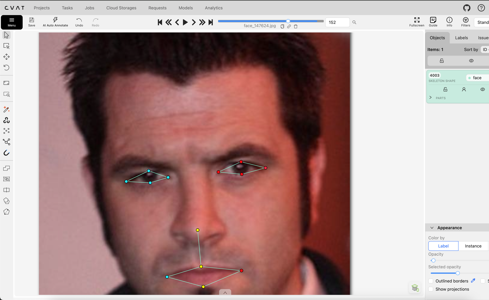
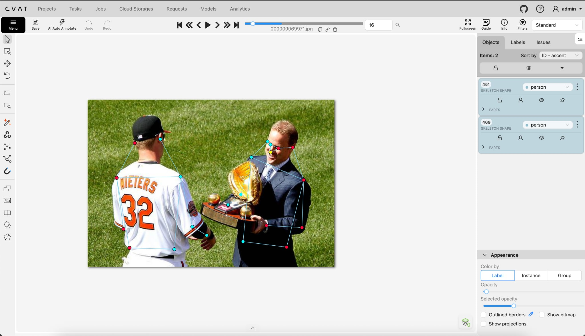
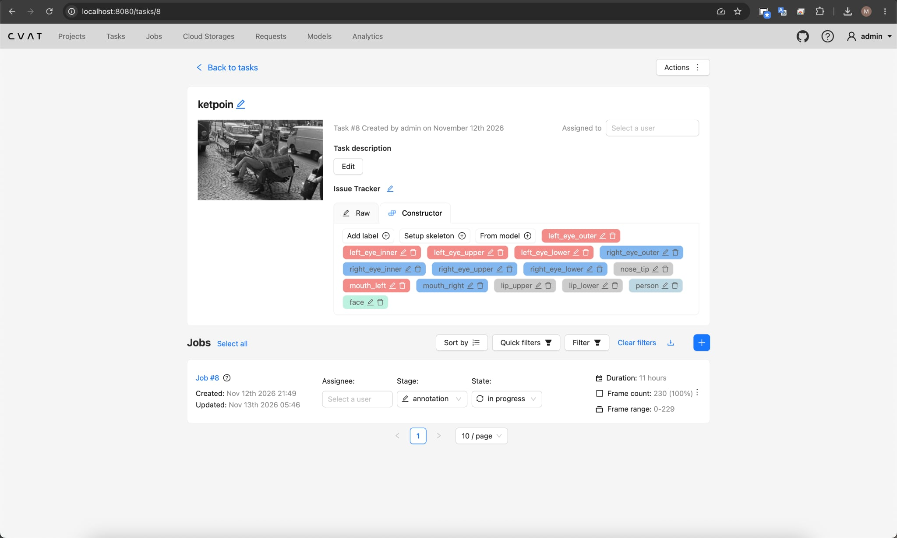
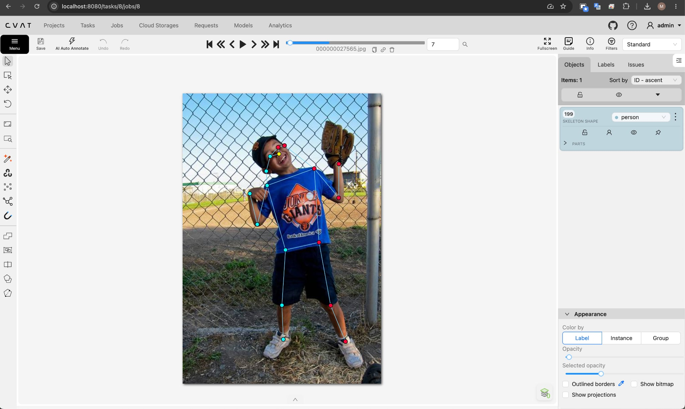

# Báo cáo cá nhân — Pham Vu Tung Duong (2A202603319)

Dữ liệu: bộ ảnh COCO 2017 được chọn theo MSSV 2A202603319. Hai file nhãn được tách từ ZIP nhãn tôi đã gán tay; tọa độ và cờ visibility được giữ nguyên.

## 0. Thông tin cá nhân

- Họ tên: Phạm Vũ Tùng Dương
- MSSV: 2A202603319
- Email: markettb89@gmail.com
- Link repository: https://github.com/zenlylove/K5-L2-DAY04-PhamVuTungDuong-2A202603319-KeypointPose
- Phiên bản CVAT (Help → About): Chưa xác minh; CVAT yêu cầu đăng nhập
- Máy: macOS · RAM và chế độ CVAT chưa xác minh
- Bộ ảnh: `src/exports/assignment.json` đã được lập theo thuật toán chia ảnh xác định trong `lab.py`, từ `pool.json` và MSSV.
- Giờ bắt đầu / kết thúc: Không ghi nhận trong phiên này; không tự ước lượng

## 1. Kiểm tra label (CP0)

| Label | Kiểu | Số điểm | Tên điểm đúng bảng của lab? | Đúng thứ tự? | Số cạnh |
|---|---|---:|---|---|---:|
| `person` | Skeleton trong COCO JSON | 17 | Có | Có | 19 |
| `face` | Skeleton trong COCO JSON | 13 | Có | Không: `lip_lower` và `lip_upper` đảo thứ tự | 13 |

## 2. Số lượng đã gán và thời gian (CP1, CP2)

Số skeleton dưới đây đếm từ hai ZIP đầu ra đã lọc, không phải nhật ký thời gian làm bài. Cột thời gian và số poster/gương/màn hình không thể suy ra từ JSON.

| Nhóm ảnh | Số ảnh | Số skeleton trong ZIP | Số người dưới 60 px được xác nhận | Số poster / gương / màn hình bỏ qua | Thời gian (phút) |
|---|---:|---:|---:|---:|---:|
| `easy` | 5 | 5 | Chưa xác minh | Chưa ghi nhận | Chưa ghi nhận |
| `occluded` | 3 | 7 | Chưa xác minh | Chưa ghi nhận | Chưa ghi nhận |
| `back` | 2 | 4 | Chưa xác minh | Chưa ghi nhận | Chưa ghi nhận |
| `small` | 1 | 1 | Chưa xác minh | Chưa ghi nhận | Chưa ghi nhận |
| `crowd` | 1 | 3 | Chưa xác minh | Chưa ghi nhận | Chưa ghi nhận |
| `faces` | 8 | 8 | — | — | Chưa ghi nhận |

- Số ảnh người hoàn thành ở mốc phút 105: Không có dữ liệu thời gian để xác nhận
- Thời gian thực tế: CP1 / CP2 / CP3 chưa ghi nhận
- Ảnh ca khó nổi bật trong bộ được giao: `000000375535.jpg` (người bị mô tô che khuất, các điểm nhìn thấy của một skeleton chỉ trải cao 38 px). Thời gian thực tế chưa được ghi lại.

## 3. Bảng ca khó (CP1, CP2)

Đối chiếu ảnh trong bộ được giao với nhãn hiện có. “Cờ hiện tại” là giá trị trong ZIP; “lựa chọn theo guideline” là điều cần kiểm tra/sửa trên CVAT trước khi export lại.

| Ảnh | Người / mặt | Điểm | Cờ hiện tại trong ZIP | Phân vân giữa | Lý do / quyết định theo guideline |
|---|---|---|---|---|---|
| `000000375535.jpg` | Người #1, một người bị mô tô che khuất | `right_hip` và hai gối/cổ chân không nhìn rõ; các điểm nhìn thấy trải cao 38 px | Phần lớn điểm đầu/thân trên và `left_hip` là `v=2`; `left_wrist`, `right_hip`, hai gối và hai cổ chân là `v=0` | Giữ skeleton với khớp khuất `v=0` hay bỏ người nếu chiều cao thật dưới 60 px | Mô tô che phần lớn thân dưới nên 38 px có thể chỉ là chiều cao các keypoint nhìn thấy, không đủ kết luận người thật dưới ngưỡng. Cần xác định chiều cao người trong ảnh; nếu đạt 60 px thì giữ skeleton và để khớp không thể ước lượng là `outside`, nếu dưới ngưỡng thì bỏ skeleton. |
| `face_296767.jpg` | Mặt đeo kính râm tối | `left_eye_upper/lower`, `right_eye_upper/lower` | Bốn điểm mí đang `v=2`; bốn điểm khóe mắt đang `v=1` | `v=1` hay `v=2` cho các điểm mắt bị kính che | Tròng kính tối che mắt; theo guideline kính râm, cả bốn điểm của mỗi mắt phải là `occluded` (`v=1`), đặt ước lượng theo gọng kính. ZIP hiện để các điểm mí `v=2`, nên cần đổi cờ trên CVAT rồi export lại. |


## 4. Bảng tự review (CP3)

Tôi đã rà lại các annotation đã lọc trong ZIP và đối chiếu các cảnh báo của checker với quy tắc trong guideline. Đây là rà soát ngoại tuyến trên dữ liệu xuất, không phải thao tác trong CVAT; các mục cần xác nhận/sửa trên CVAT được ghi rõ, không coi cảnh báo tự động là lỗi chắc chắn.

Mã lỗi dùng đúng một trong: `lr_swap`, `vis_flag`, `position`, `missing`, `extra`, `ok`.

| Ảnh | Người / mặt | Điểm | Mã lỗi | Ghi chú | Đã sửa? |
|---|---|---|---|---|---|
| `000000309169.jpg` | Người trong ảnh crowd | Toàn bộ skeleton đã gán | `ok` | Rà số lượng skeleton và cấu trúc điểm trong ảnh crowd; không có cảnh báo vị trí cụ thể của checker cho ảnh này | Không cần sửa |
| `000000210604.jpg` | Người quay lưng | Toàn bộ skeleton đã gán | `ok` | Rà các điểm có trong annotation; ảnh thuộc nhóm `back`, không có cảnh báo cụ thể từ checker | Không cần sửa |
| `000000123544.jpg` | Người #1 | Hai gối | `lr_swap` | Checker báo cặp gối lệch phía so với các cặp khác. Chưa đủ căn cứ ngoại tuyến để kết luận là đổi trái/phải hay tư thế chân bắt chéo thật; cần xác nhận trực quan trong CVAT | Chưa sửa; chưa đăng nhập được CVAT |
| `000000393909.jpg` | Người trong ảnh bị che khuất | Toàn bộ skeleton đã gán | `ok` | Rà các annotation trong ảnh occluded; không có cảnh báo cụ thể từ checker | Không cần sửa |
| `000000558066.jpg` | Người #1 | Toàn bộ skeleton | `ok` | Rà các điểm có trong annotation; không có cảnh báo cụ thể từ checker | Không cần sửa |
| `face_85624.jpg` | Mặt #1 | `right_eye_inner`, `right_eye_outer` | `position` | Checker cảnh báo quan hệ gần sống mũi. Đây là dấu hiệu cần phóng to để xác nhận, không đủ để tự kết luận vị trí sai | Chưa sửa; chưa đăng nhập được CVAT |
| `face_575921.jpg` | Mặt #1 | `right_eye_inner`, `right_eye_outer` | `position` | Cùng loại cảnh báo về hai khóe mắt; cần đối chiếu ảnh phóng to và hướng mặt | Chưa sửa; chưa đăng nhập được CVAT |
| `face_296767.jpg` | Mặt đeo kính râm | Bốn điểm mí mắt | `vis_flag` | Guideline yêu cầu bốn điểm mắt sau kính râm tối ở `v=1`; hiện bốn điểm mí là `v=2` (xem mục 3) | Chưa sửa; chưa đăng nhập được CVAT |

Tổng hợp số lỗi theo mã:

| `lr_swap` | `vis_flag` | `position` | `missing` | `extra` | `ok` |
|---:|---:|---:|---:|---:|---:|
| 1 | 1 | 2 | 0 | 0 | 4 |

Điểm còn phân vân giữa `v = 1` và `v = 0`: ở `000000375535.jpg`, các khớp thân dưới khuất sau mô tô. Tôi giữ các điểm không thể ước lượng chắc chắn ở `v=0`; chỉ chuyển sang `v=1` nếu có thể ước lượng vị trí khớp đáng tin cậy. Chưa thể xác nhận hoặc sửa quyết định này trên CVAT.

## 5. Kiểm file xuất và kết quả tự kiểm (CP4)

Từ ZIP nhãn của tôi, đã lọc ảnh theo bộ MSSV 2A202603319 và tách hai loại annotation vào `src/exports/PhamVuTungDuong_persons.zip` (12 ảnh, 20 skeleton) và `src/exports/PhamVuTungDuong_faces.zip` (8 ảnh, 8 skeleton). Tọa độ và cờ visibility được giữ nguyên. Danh sách ảnh trong `assignment.json` được tính lại từ thuật toán của `lab.py`; file hiện không có metadata tài khoản/task/job do chưa xác minh được CVAT setup. Đây là kết quả kiểm bằng script, chưa thay thế việc xác nhận hai job completed trên CVAT.

```text
- File persons: 12 ảnh · 20 skeleton · 51 số keypoints/annotation · v=2: 288, v=1: 5, v=0: 47
- File faces: 8 ảnh · 8 skeleton · 39 số keypoints/annotation · v=2: 100, v=1: 4, v=0: 0
- Số [LỖI]: 0 · số [CẢNH BÁO]: 12 (3 cảnh báo person, 9 cảnh báo face)
Kết quả: ĐẠT (đọc lại từng cảnh báo ở trên)
```

| Ảnh | Nhãn / điểm | Cảnh báo tự động | Việc cần làm |
|---|---|---|---|
| `000000123544.jpg` | `person`, gối | Vị trí trái/phải đầu gối không nhất quán với cặp điểm khác | Mở ảnh, xác định có phải tư thế bắt chéo thật hay `lr_swap`; chỉ sửa trên CVAT nếu xác nhận sai |
| `000000294379.jpg` | `person`, cổ chân | Cặp cổ chân lệch phía so với các cặp khác | Mở ảnh và kiểm tra hướng người / chân bắt chéo |
| `000000375535.jpg` | `person` #1 | Chiều cao điểm chỉ trải 38 px (< 60 px) | Kiểm tra có phải người nhỏ dưới ngưỡng hoặc người bị cắt khung |
| 8 ảnh `face` trong ZIP | `right_eye_outer`, `right_eye_inner` | Checker cảnh báo thứ tự khóe mắt phải | Phóng to từng mắt và xác nhận vị trí theo sống mũi |
| Schema `face` | thứ tự keypoint | `lip_lower` đứng trước `lip_upper`, khác thứ tự guideline | Báo coach / kiểm tra label nguồn; không sửa JSON export bằng tay |

Tự kiểm tra thủ công tọa độ và cờ visibility: Chưa hoàn tất. Trạng thái hai job CVAT: Chưa xác minh.

## 6. Ảnh chụp màn hình

Thư mục `report/individual/images/` hiện có bốn ảnh chụp CVAT. Tôi chèn các ảnh đang có dưới đây; tên file được giữ nguyên.

1. `image.png` — Ảnh mặt đã gán, phóng to vùng mắt.



2. `2c951bba-c6ad-46c9-9e5c-fa159a933639.png` — Hai skeleton người trong ảnh, có các điểm đã gán.



3. `35fe2d2c-5e4b-49ca-acd1-bf565c9388c9.png` — Trang task CVAT với phần Constructor và danh sách label.



4. `9e16e714-61e7-4b66-bd54-8b8c29e9653f.png` — Một skeleton người đã gán, nhìn thấy toàn thân và các điểm.



Các ảnh này xác nhận có ảnh chụp CVAT, nhưng chưa thể hiện rõ toàn bộ 17 tên điểm của label `person` và không có ảnh JSON export. Ảnh trang task cũng cho thấy job đang `in progress`, vì vậy chưa thể kết luận hai job đã completed.

## 7. Tự đánh giá

Qua đối chiếu nhãn và guideline, điểm cần sửa rõ nhất là visibility của các điểm mắt dưới kính râm tối ở `face_296767.jpg`. Đây là tự đánh giá dựa trên dữ liệu xuất, không phải xác nhận rằng tôi đã sửa nhãn trên CVAT.

1. Lỗi đáng chú ý và cách tránh: gán `v=2` cho bốn điểm mí mắt bị kính râm tối che. Cần kiểm tra loại kính trước khi đặt cờ: kính râm tối dùng `v=1` nếu vị trí có thể ước lượng chắc; dùng `v=0` nếu không thể ước lượng.
2. Quy tắc nên nhấn mạnh thêm: cảnh báo hình học tự động chỉ là tín hiệu rà soát, nhất là với mặt nghiêng hoặc tư thế bắt chéo; xác nhận trái/phải theo hướng của người trong ảnh trước khi sửa.
3. Ảnh hưởng tới mô hình: điểm mắt đang ở `v=2` được tính như điểm nhìn thấy và góp vào loss như một tọa độ mục tiêu chính xác. Nếu mắt bị kính che, giữ `v=2` có thể buộc mô hình học vị trí không quan sát được. Đổi sang `v=1` giữ điểm ước lượng nhưng biểu thị bị che; nếu không ước lượng chắc thì `v=0` loại điểm khỏi loss.

## 8. Khó khăn và lỗi kỹ thuật

- ZIP ban đầu `keypoin.zip` chỉ có metadata 230 ảnh và 0 annotation. ZIP mới `keypooin1.0.zip` có nhãn tôi tự gán tay. Tôi đã dùng ảnh được giao theo MSSV để tách file persons/faces, không thay tọa độ/cờ visibility.

## 9. Tài liệu tham khảo và công cụ AI đã dùng

- Trợ lý AI (Copilot SDK trong VS Code): đọc tài liệu dự án và rà checklist nộp bài; không dùng để tạo tọa độ nhãn.
